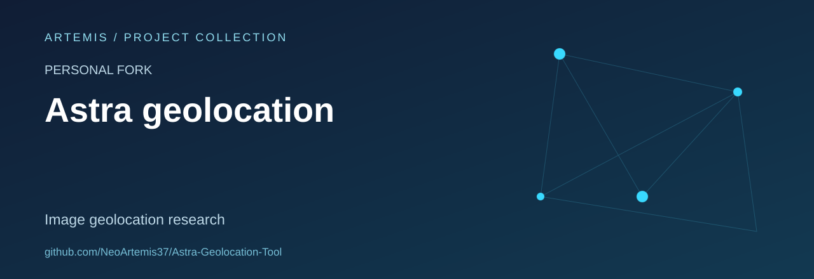

# Astra Geolocation Tool

**Personal research fork of [Netryx Astra V2](https://github.com/sparkyniner/Netryx-Astra-V2-Geolocation-Tool).**

A study workspace for image-based geolocation and visual place-recognition architectures. The original project combines image retrieval, visual matching and spatial reasoning. This fork overview makes its provenance and scope explicit without claiming original authorship, independently verified accuracy or a separate release.

## What is in this snapshot

| Area | Repository evidence |
| --- | --- |
| Visual retrieval | `megaloc_model.py`, `megaloc_utils.py` and `mixvpr_utils.py` |
| Visual matching | `mast3r_utils.py` |
| Application interface | `netryx_hub.py` |
| Dependency declarations | `requirements.txt` |
| Existing illustration | `assets/demo.gif` |

## Study focus

- Understand how computer-vision components fit together.
- Review model dependencies and the separation between retrieval, matching and presentation.
- Evaluate limitations using consented or self-created imagery and suitable test data.

The presence of a model or demo asset does not establish accuracy, coverage or production readiness. No performance benchmark is claimed by this overview.

## Provenance and licensing

Upstream: **[sparkyniner/Netryx-Astra-V2-Geolocation-Tool](https://github.com/sparkyniner/Netryx-Astra-V2-Geolocation-Tool)**.

The inspected snapshot does not contain a root `LICENSE` file. Consult the upstream licensing information before redistributing or incorporating the project. Existing author credits remain with the original project.

Fork-specific implementation changes and upstream contributions have not been assessed in this documentation review.
